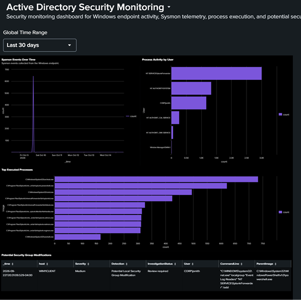
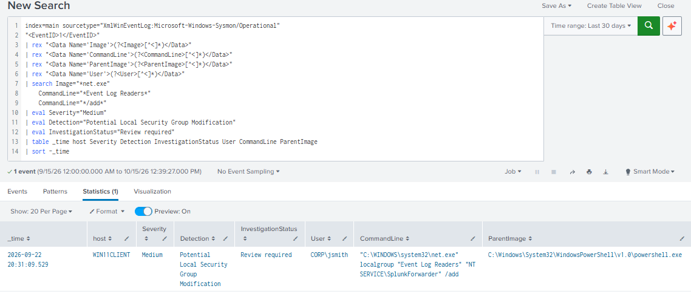
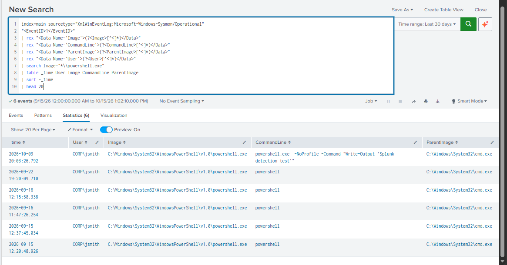

## active-directory-security-monitoring
Active Directory security monitoring and threat detection using Sysmon and Splunk

## Overview

This project demonstrates Windows endpoint security monitoring in a virtualized Active Directory lab. Sysmon collects endpoint telemetry, Splunk Universal Forwarder forwards Windows event logs, and Splunk Enterprise is used to search, investigate, and visualize security-related activity.

## Lab Architecture

- Domain Controller: Windows Server 2022 (dc01)

- Active Directory Domain: corp.local

- Endpoint: Windows 11 Pro (WIN11CLIENT)

- Endpoint Telemetry: Sysmon with a SwiftOnSecurity configuration

- Log Collection: Splunk Universal Forwarder

- SIEM and Visualization: Splunk Enterprise

- Virtualization: Oracle VirtualBox

## Implemented Features

- Configured a Windows Server Active Directory domain and Windows endpoint.

- Installed and configured Sysmon to collect endpoint telemetry.

- Forwarded Windows Application, System, Security, and Sysmon Operational logs to Splunk.

- Troubleshot Windows Event Log permissions to enable Sysmon log collection.

- Used SPL and regular expressions to extract fields from raw Sysmon XML events.

- Investigated process creation, executable paths, usernames, command lines, and parent processes.

- Developed a query to identify a specific net.exe command-line pattern associated with local security-group modifications.

- Created a Splunk dashboard with event trends, process activity by user, frequently executed processes, and a potential security-group modification table.

## Dashboard Preview

## Detection Example

The following detection identifies a specific `net.exe` command-line pattern associated with a local security-group modification. The observed event was an expected administrative action during lab configuration.

## Sysmon Process Investigation

This search extracts process execution details from Sysmon XML events, including the user, executable path, command line, and parent process.

## Skills Demonstrated

- Windows Server and Active Directory

- Windows endpoint logging and Sysmon

- Splunk Enterprise and Universal Forwarder

- Search Processing Language (SPL)

- XML field extraction and regular expressions

- Security event investigation

- Detection logic development

- SIEM dashboard creation

- Troubleshooting Windows Event Log permissions

## Future Improvements

- Develop and validate additional detections for PowerShell, DNS, and network activity.

- Improve field extraction and normalize event fields.

- Add investigation notes and examples of benign versus suspicious activity.

- Expand the dashboard with additional security-focused views.

## Disclaimer

This project is a personal learning lab using virtual machines and test data. Detection results require investigation and should not be interpreted as definitive proof of malicious activity.
